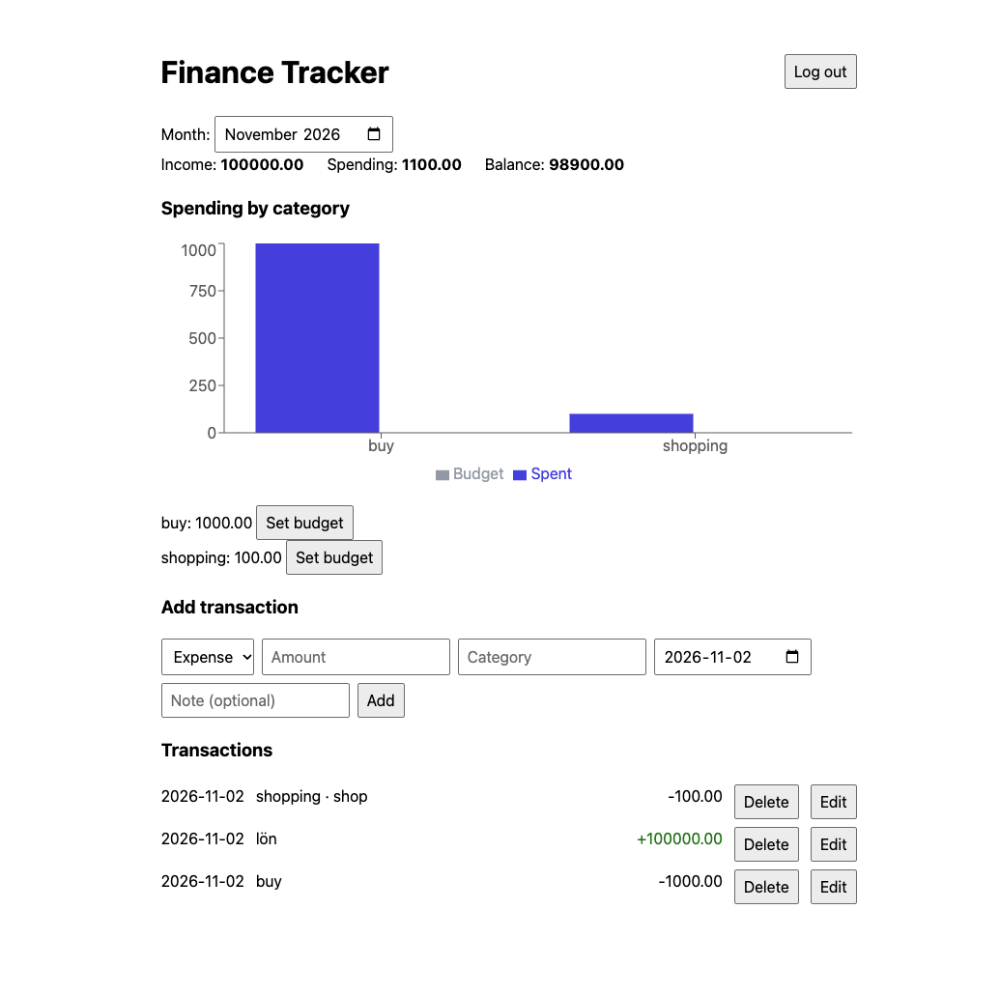

# Finance Tracker

A full-stack personal finance app. Register an account, record income and expenses, see a monthly summary, and set a budget for each spending category. Every user sees only their own data.



> Add a screenshot at `docs/dashboard.png` (or remove the line above).

## Table of contents

- [Features](#features)
- [Tech stack](#tech-stack)
- [Project structure](#project-structure)
- [Getting started](#getting-started)
- [Environment variables](#environment-variables)
- [Available scripts](#available-scripts)
- [How it works](#how-it-works)
- [API reference](#api-reference)
- [Database schema](#database-schema)
- [Security notes](#security-notes)
- [Troubleshooting](#troubleshooting)
- [Known limitations](#known-limitations)
- [Roadmap](#roadmap)
- [Author](#author)

## Features

- **Authentication:** register and log in with email and password. Passwords are hashed with bcrypt, and sessions use signed JWTs that expire after 7 days.
- **Transactions:** add, edit, and delete income and expense entries with amount, category, date, and an optional note.
- **Monthly summary:** pick a month to see total income, total spending, balance, and spending per category.
- **Budgets:** set a monthly limit for any category. Categories over their limit are highlighted in red.
- **Chart:** a bar chart compares spending with budget for each category.
- **Data isolation:** every database query is scoped to the logged-in user, so one account can never read or change another account's data.

## Tech stack

| Layer      | Technology                                        |
| ---------- | ------------------------------------------------- |
| Frontend   | React 19 (Vite), Recharts                         |
| Backend    | Node.js, Express                                  |
| Database   | SQLite via `better-sqlite3`                       |
| Auth       | `bcryptjs` for password hashing, `jsonwebtoken`   |

## Project structure

```
finance-tracker/
├── backend/
│   ├── auth.js            # JWT signing and the requireAuth middleware
│   ├── db.js              # SQLite connection and table creation
│   ├── server.js          # Express app and all API routes
│   ├── .env.example       # Template for required environment variables
│   └── package.json
├── frontend/
│   ├── src/
│   │   ├── api.js             # fetch wrapper that attaches the JWT
│   │   ├── App.jsx            # Switches between login and dashboard
│   │   ├── Login.jsx          # Login and register form
│   │   ├── Dashboard.jsx      # Month picker, data loading, transaction list
│   │   ├── Summary.jsx        # Totals and per-category budgets
│   │   ├── TransactionForm.jsx# Add and edit form
│   │   ├── CategoryChart.jsx  # Spending vs. budget bar chart
│   │   ├── main.jsx
│   │   └── index.css
│   ├── vite.config.js     # Dev server with /api proxy to the backend
│   └── package.json
├── .gitignore
└── README.md
```

## Getting started

### Prerequisites

- **Node.js 20.6 or newer.** The backend uses Node's built-in `--env-file` flag.
- **npm**, which comes with Node.
- **git**.

`better-sqlite3` ships prebuilt binaries for common platforms. If the install fails on your machine, you may need your platform's C++ build tools.

### 1. Clone the repository

```bash
git clone https://github.com/will3343/finance-tracker.git
cd finance-tracker
```

### 2. Set up the backend

```bash
cd backend
npm install
cp .env.example .env
```

Open `backend/.env` and set `JWT_SECRET` to a long random string. You can generate one with:

```bash
node -e "console.log(require('crypto').randomBytes(32).toString('hex'))"
```

Start the API:

```bash
npm run dev
```

You should see `API running on http://localhost:3001`. The SQLite database file `finance.db` is created in `backend/` on first start.

### 3. Set up the frontend

In a second terminal:

```bash
cd frontend
npm install
npm run dev
```

Open the URL Vite prints, usually <http://localhost:5173>. Create an account and start adding transactions.

## Environment variables

Defined in `backend/.env` (never commit this file):

| Variable     | Required | Description                                               |
| ------------ | -------- | --------------------------------------------------------- |
| `JWT_SECRET` | Yes      | Secret used to sign login tokens. The server refuses to start without it. |

## Available scripts

**Backend** (`backend/`)

| Command       | What it does                                              |
| ------------- | --------------------------------------------------------- |
| `npm run dev` | Starts the API with auto-restart when files change        |
| `npm start`   | Starts the API once, without file watching                |

**Frontend** (`frontend/`)

| Command           | What it does                              |
| ----------------- | ----------------------------------------- |
| `npm run dev`     | Starts the Vite dev server with hot reload |
| `npm run build`   | Creates a production build in `dist/`     |
| `npm run preview` | Serves the production build locally       |
| `npm run lint`    | Runs ESLint                               |

## How it works

1. The frontend calls `/api/...`. In development, Vite's proxy forwards these requests to the Express server on port 3001, so the browser never makes a cross-origin request.
2. On register or login, the server returns a JWT. The frontend stores it in `localStorage` and sends it in an `Authorization: Bearer <token>` header with every request.
3. A middleware (`requireAuth`) verifies the token and sets `req.userId`. Every route below the login and register endpoints requires it.
4. Every SQL query includes `user_id = ?` with the id from the verified token, not anything the client sends. This is what keeps users' data separate.
5. The summary endpoint does the math in SQL (`SUM` with `GROUP BY`), then joins the results with the user's budgets.

## API reference

All endpoints are under `/api`. Endpoints marked **Auth** need an `Authorization: Bearer <token>` header and return `401` without a valid one.

| Method | Endpoint                 | Auth | Description                                   |
| ------ | ------------------------ | ---- | --------------------------------------------- |
| POST   | `/register`              | No   | Create an account, returns `{ token }`        |
| POST   | `/login`                 | No   | Log in, returns `{ token }`                   |
| GET    | `/transactions`          | Yes  | List the user's transactions, newest first    |
| POST   | `/transactions`          | Yes  | Create a transaction                          |
| PUT    | `/transactions/:id`      | Yes  | Update one of the user's transactions         |
| DELETE | `/transactions/:id`      | Yes  | Delete one of the user's transactions         |
| GET    | `/budgets`               | Yes  | List the user's category budgets              |
| PUT    | `/budgets/:category`     | Yes  | Create or update a budget for a category      |
| GET    | `/summary?month=YYYY-MM` | Yes  | Totals and per-category spending for a month  |

### Example requests

Register and save the token:

```bash
curl -X POST http://localhost:3001/api/register \
  -H "Content-Type: application/json" \
  -d '{"email":"you@example.com","password":"password123"}'
```

Add a transaction:

```bash
curl -X POST http://localhost:3001/api/transactions \
  -H "Authorization: Bearer $TOKEN" \
  -H "Content-Type: application/json" \
  -d '{"type":"expense","amount":45.5,"category":"Food","date":"2026-11-02","note":"Groceries"}'
```

Set a budget and fetch the summary:

```bash
curl -X PUT http://localhost:3001/api/budgets/Food \
  -H "Authorization: Bearer $TOKEN" \
  -H "Content-Type: application/json" \
  -d '{"monthly_limit":400}'

curl "http://localhost:3001/api/summary?month=2026-11" \
  -H "Authorization: Bearer $TOKEN"
```

Example summary response:

```json
{
  "month": "2026-11",
  "income": 3000,
  "expenses": 45.5,
  "balance": 2954.5,
  "byCategory": [
    { "category": "Food", "total": 45.5, "budget": 400, "over": false }
  ]
}
```

### Validation and errors

- `400` for missing or invalid fields (for example a password shorter than 8 characters or a malformed `month`).
- `401` for a missing, invalid, or expired token, or wrong login credentials.
- `404` when a transaction does not exist or belongs to another user.
- `409` when registering an email that is already in use.

## Database schema

SQLite, created automatically by `backend/db.js`.

**users**

| Column          | Type    | Notes              |
| --------------- | ------- | ------------------ |
| `id`            | INTEGER | Primary key        |
| `email`         | TEXT    | Unique, lowercased |
| `password_hash` | TEXT    | bcrypt hash        |

**transactions**

| Column     | Type    | Notes                                  |
| ---------- | ------- | -------------------------------------- |
| `id`       | INTEGER | Primary key                            |
| `user_id`  | INTEGER | Foreign key to `users.id`              |
| `type`     | TEXT    | `income` or `expense`                  |
| `amount`   | REAL    |                                        |
| `category` | TEXT    |                                        |
| `date`     | TEXT    | `YYYY-MM-DD`                           |
| `note`     | TEXT    | Optional                               |

**budgets**

| Column          | Type    | Notes                                  |
| --------------- | ------- | -------------------------------------- |
| `id`            | INTEGER | Primary key                            |
| `user_id`       | INTEGER | Foreign key to `users.id`              |
| `category`      | TEXT    | Unique per user                        |
| `monthly_limit` | REAL    |                                        |

## Security notes

- Passwords are never stored in plain text. They are hashed with bcrypt before saving.
- All SQL uses parameterized queries, which prevents SQL injection.
- The JWT secret comes from an environment variable and is never committed.
- Ownership checks are part of the SQL (`WHERE id = ? AND user_id = ?`), so editing or deleting someone else's record returns `404`.
- Tokens are stored in `localStorage`, which is simple but readable by any script on the page (XSS). A production app should consider httpOnly cookies.

## Troubleshooting

- **`JWT_SECRET is not set`:** create `backend/.env` from `.env.example` and run the backend from the `backend/` folder.
- **`Cannot GET /api/...` after changing the backend:** an old server process may still be running. Stop it, or find it with `lsof -i :3001`.
- **Logged out unexpectedly:** changing `JWT_SECRET` invalidates all existing tokens. Log in again.
- **`SqliteError` on startup after schema changes:** the existing `finance.db` still has the old tables. For development data you can delete `backend/finance.db` and restart.

## Known limitations

- No rate limiting on login attempts.
- CORS is open in the backend (the app relies on the Vite proxy in development).
- Budgets are edited with a browser prompt, and there is no password reset or email verification.
- No automated tests yet.
- Not yet set up for deployment (the frontend is served by Vite in development, and the SQLite file needs persistent storage in production).

## Roadmap

- [ ] API tests, including a check that users cannot read each other's data
- [ ] Inline budget editing instead of a browser prompt
- [ ] Deployment (Express serving the built React app, SQLite on a persistent disk)
- [ ] CSV import and export
- [ ] Recurring transactions
- [ ] Migration to TypeScript

## Author

Built by [will3343](https://github.com/will3343) as a learning project while studying full-stack web development.
